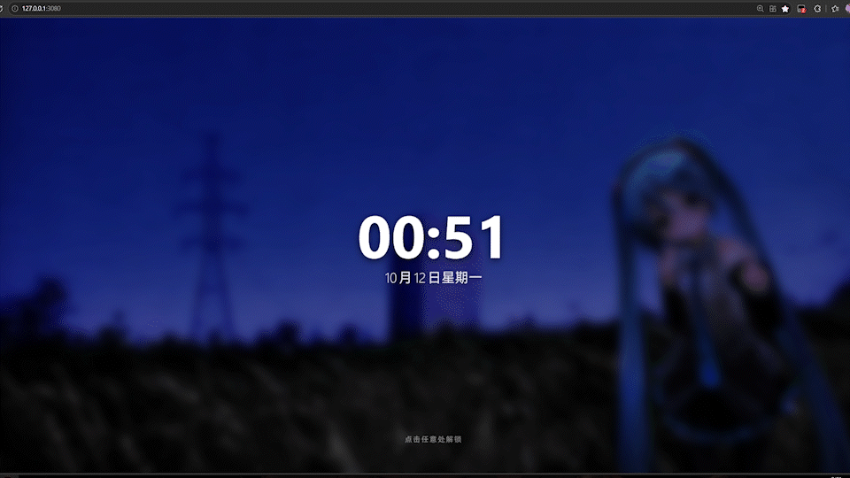
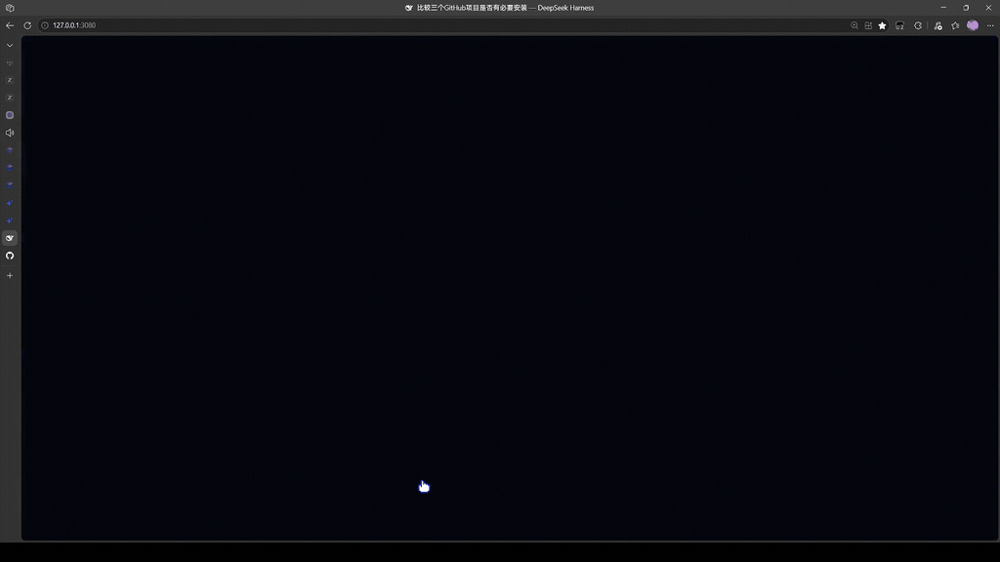
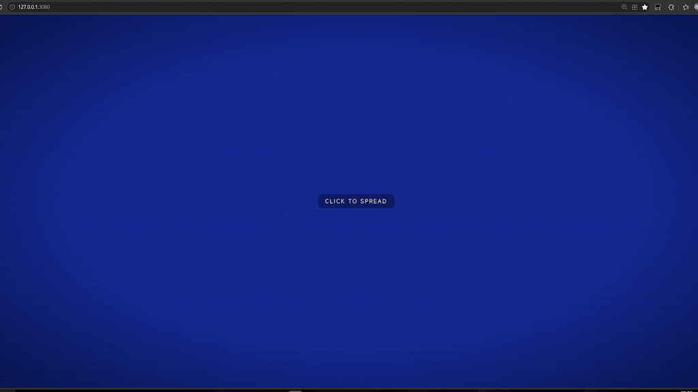

# dsh-opening-animation

[中文](README.md)

An opening-animation plugin for DeepSeek Harness Web: every time a dsh web page loads, a fullscreen overlay plays the opening content you picked — an image animation or a video — then a configurable transition hands the screen back to the UI. Structurally identical to [dsh-custom-skin](https://github.com/SLin-code/dsh-custom-skin) and can run alongside it.

## Features

- **Image openings** (jpg/png/webp/gif/avif, ≤20 MB, decode-probed at import and rejected past 32 megapixels (≈ an 8K frame), library cap of 8 items; capacity cut-offs and decode failures are reported, never dropped silently)
- **Image opening playback order** (single / sequence / shuffle, single by default): decides which image opening plays at each startup — sequence starts from the selected animation, then advances through the image list on each startup, wrapping around; shuffle never repeats the previous one when there is more than one; the preview always plays the selected media, and videos ignore this setting
- **Video openings** (mp4/webm/mkv, ≤256 MB, decode support probed at import): audible-first autoplay (the engine always attempts to unmute on the first playing event: it plays audible at the configured volume when the browser allows audible autoplay — a user gesture, a high Media Engagement Index, or an allow-listed site — and falls back to muted playback automatically when the browser rejects audible autoplay, so the picture never freezes), the transition runs when the video ends, long videos are never cut off; fit (fill screen cover / show full frame contain, default cover) plus scale and horizontal/vertical offsets are adjustable (scale defaults to 1 = no zoom, offsets to 0 = centered, in percent of the screen width/height); near the end the audio fades out along an exponential curve (fast at first, then slower), with an adjustable fade length (1.5 s by default, 0 = off)
- **Hand-off transitions**: cross-fade (default) / dip-to-bg / zoom-fade, speed adjustable (0.5–2×); while an animation plays the overlay holds the UI down (`#root` is pinned by a pending attribute so no frame flashes), and is restored once the transition ends
- **Skip anytime**: click anywhere or press Esc (the skip hint in the lower right can be turned off; tap-reveal's first click is reserved for starting the reveal — every later click follows the same rule as the other animations)
- **Settings page** (Personalization › Opening animation): a **Language** picker at the top switches the whole DSH Web interface language; upload/pick/remove/clear media (a full library or a batch cut by the cap is reported explicitly; the advanced parameters' text fields share one set of theme tokens with the number/dropdown controls, so they blend into the wallpaper style when dsh-custom-skin is installed), switch animation and transition, adjust advanced parameters, preview, restore defaults; startup playback is off by default and must be enabled in the settings
- **Guardrails & fail-open**: the UI can never be trapped. Fatal engine errors (storage unavailable, media missing, image failing to load, …) tear the overlay down immediately without a transition; three watchdogs — the 8 s load timeout (lifted once the engine reports readiness), the image time limit (default 15 s, adjustable 3–120 s: a forced hand-off insurance only, it never sets the playback length, which comes from each animation's own parameters; videos are exempt) and the 10 s video-stall check (covers mid-playback buffering drop-offs, not just initial data readiness) — hand the screen back with a transition; a full browser storage quota is reported as its own error. Preview ignores the once-per-page-load guard and plays even under prefers-reduced-motion (the unattended startup playback still honors it)
- **Accessibility**: while an opening plays the UI root is made inert (keyboard focus cannot land on the hidden controls), the decorative canvas is hidden from screen readers (the skip hint text stays readable), and the previous focus is restored on teardown
- **dsh-custom-skin handoff** (off by default): when enabled, uploaded images are copied into the wallpaper library as well — one-way, and never changes the skin's preferences

### Image opening animations

**glass**



**"404"**


**tap-reveal**



**wipe-reveal**


**pool**


**grid-reveal-spread**



**retro-boot**


**code-rain**


A standalone visual prototype (single file, embedded assets, supports `?t=<seconds>` to freeze one frame): [docs/retro-boot.html](docs/retro-boot.html)

### Video opening


## Build

Requires Node ^22.19.0 or ≥24:

```sh
pnpm install
pnpm check   # typecheck + vitest + build
```

CI ([.github/workflows/ci.yml](.github/workflows/ci.yml)) runs `pnpm check` plus a packaging check on a Node 22.19 / 24 matrix. The test suite is jsdom-level unit/behavior testing (controller, watchdogs, every animation engine, preference parsing); canvas rendering, media decoding and the real playback path need manual verification in a real browser — the "Preview opening" button on this plugin's settings page in a running dsh web instance is the recommended manual regression path.

## Install into a dsh web profile

```sh
cd $DSH_HOME/profiles/web
pnpm add <path to this directory or a tarball>
# then add "dsh-opening-animation" to the dsh.profile.bundles array
# in the profile's package.json
```

## Adding a new animation

A new animation = one engine file + one registration line in `registry.ts`; parameters declared via `paramsSchema` are rendered by the settings page automatically, with zero changes to the playback path (ADR-003).

## License

MIT
