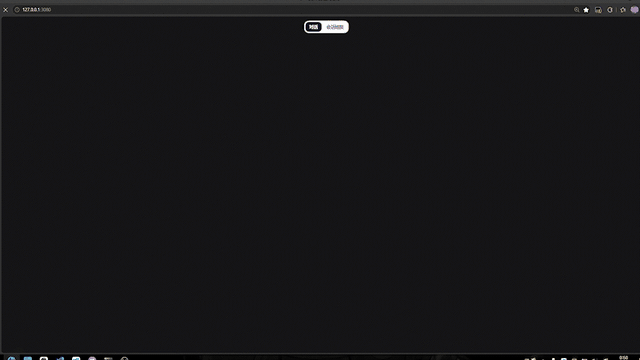
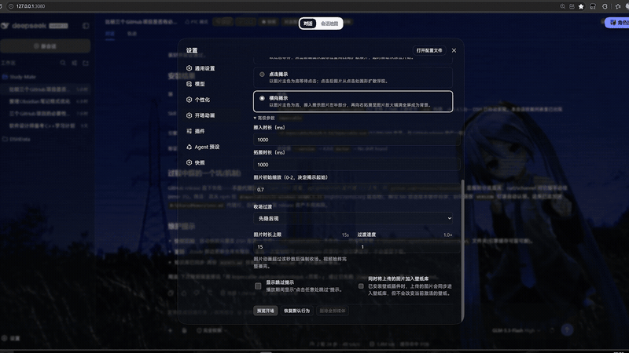
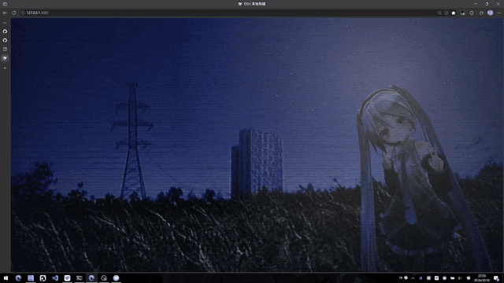
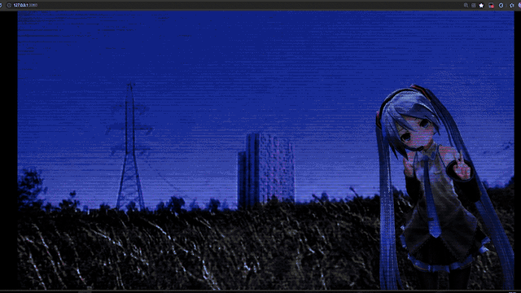
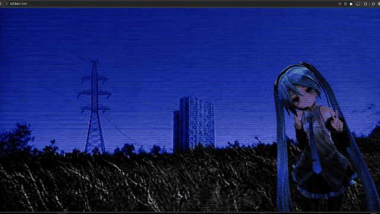
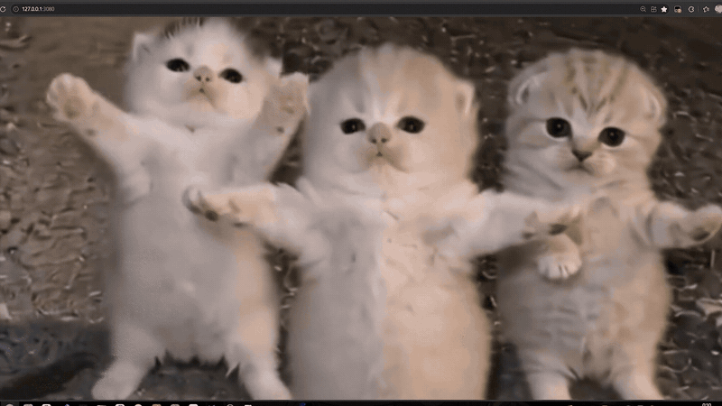

# dsh-opening-animation

[English](README.en.md)

DeepSeek Harness Web 的开场动画插件：每次 dsh web 页面加载时，在全屏遮罩上播放你选择的开场内容——图片动画或视频——结束后以可配置的过渡效果把画面交还主界面。完美兼容 [dsh-custom-skin](https://github.com/SLin-code/dsh-custom-skin) 

## 功能

- **图片开场**（jpg/png/webp/gif/avif，≤20 MB，导入时实测解码并拒绝超过 3200 万像素（约 8K 幅面）的图片，库上限 8 条；容量截断与解码失败都会明确提示，不会静默丢弃）
- **图片开场播放顺序**（单一/顺序/随机，默认单一）：决定每次启动播放哪张图片开场——顺序从选中项开始，每次启动按图片列表推进、到末尾回绕；随机在多于一张时绝不重复上一张；预览始终播放选中媒体，视频不受此项影响
- **视频开场**（mp4/webm/mkv，≤256 MB，导入时探测解码支持）：自动播放时引擎在首个 playing 事件一律尝试取消静音——浏览器允许有声自动播放时（用户手势、站点媒体参与度达标或站点在浏览器声音允许列表中）按音量设置出声；浏览器拒绝时自动回退为静音播放，画面不会因此卡住，回退为静音时开场画面会出现『点击开启声音』提示，点击即可解除静音（该点击不会跳过动画），播完收场，长视频不截断；填充方式（铺满 cover / 完整显示 contain，默认 cover）与缩放、水平/垂直偏移可调（缩放默认 1 不缩放，水平/垂直偏移默认 0 居中，单位为屏幕宽/高的百分比）；视频结尾音频按指数曲线淡出（先快后慢），淡出时长可调（默认 1.5 秒，0 为禁用）；视频开头音频按恒定增益（线性）淡入，时长可调（默认 1 秒，0 为禁用），点按『点击开启声音』解除静音时同样淡入
- **收场过渡**：cross-fade（默认）/ dip-to-bg / zoom-fade，速度可调（0.5–2×）；动画期间主界面被遮罩按住（`#root` 由 pending 属性压住不闪帧），过渡结束后还原
- **启动画面早期覆盖**：两级机制，尽早盖住宿主官方启动画面与 app 首帧。第一级是宿主端 index 注入（serve 部署下 webserver 把一行内联脚本放进 index.html 的 head）：HTML 解析阶段即读取偏好，已开启开场动画时先于官方「HARNESS / Loading plugins...」加载屏渲染压暗 `#root` 与文档背景，官方加载屏零帧可见；第二级是原有 client 端遮罩，插件 bundle 被评估时同步挂上全屏深色盖，作为无 index 注入的部署形态下的退化保障。两级走同一条撤除链收尾：controller 的每个终点（本次不播放、存储错误、播完交还、挂载失败）都连同 pending 状态一并移除注入样式与遮罩，client 级遮罩另带 4 秒兜底定时器强制移除，任何路径都不会永久黑屏。能力边界：注入级未生效的部署形态下，官方加载屏仍会显示到 bundle 评估为止，这约 1 秒的宿主加载期插件无法覆盖
- **随时跳过**：点击任意处或 Esc（右下角跳过提示可关；tap-reveal 的第一击固定用于开始揭示，此后规则与其他动画一致）
- **设置页**（个性化 › 开场动画）：顶部 Language 项切换整个 DSH Web 的界面语言；上传/选择/删除/清空媒体（库满或批量导入被上限截断时明确提示，高级参数的文本输入框与数字/下拉控件共用同一套主题令牌，安装 dsh-custom-skin 时随壁纸风格自动融合）、切换动画与过渡、调整高级参数、预览、恢复默认行为；启动播放默认关闭，需在设置中开启
- **保险与 fail-open**：主界面永远可用。引擎致命错误（存储打不开、媒体缺失、图片加载失败等）立即无过渡撤除遮罩；三道看门狗——加载超时 8s（引擎上报媒体就绪后即解除）、图片超过时长上限（默认 15s、可调 3–120s：仅是强制收场保险，不决定播放时长，实际时长由动画自身参数决定；视频不受限）、视频无进度 10s（覆盖播放中途缓冲掉级的情形，不只看数据就绪状态）——触发时带过渡收场；浏览器存储配额已满时写入失败单独提示。预览不受「每次页面加载只播一次」限制，与启动播放行为一致。
- **无障碍**：播放期间主界面进入 inert 状态（键盘焦点不会落入被遮住的控件），装饰画布对屏幕阅读器隐藏（跳过提示文字保留可读），遮罩撤除后恢复原焦点
- **与 dsh-custom-skin 联动**（默认关闭）：开启后上传的图片可同步复制进壁纸库，单向、不改皮肤偏好

### 图片开场动画

**"404"**



**wipe-reveal**



**pool**



**grid-mouse**


**retro-boot**



**code-rain**



**constructivism1**

以你的图片或视频为核心的构成主义海报拼贴：暖纸底与墨黑几何、构成主义蓝斜条、蓝楔形与半调网点；画面在锐利多边形窗口中展开并叠加深蓝错位套准层。文字系统全部可自定义：

- **标题大字**（`caption` 参数）：左栏逐个砸入的字块，默认 `DEEPSEEK|HARNESS`，用 `|` 分行（最多 3 行，留空回退默认）；字块按行号在墨黑底/米色底之间交替
- **左上角小字**（`brandText` 参数）：斜切墨黑品牌板，默认 `DEEPSEEK`，留空回退默认
- **字体**（`fontFamily` 参数）：整张海报的字体栈，留空用内置字体
- **底随文字自适应**：墨黑/米色底板宽度始终收缩包裹文字——字长则底长、字短则底短；超长文字不会被截断，而是在列宽内等比缩小字号（窗口变化、字体就绪时自动重新适配）

视频版（`constructivism1-video`）同款海报构图与文字参数，视频作为纯背景层播放。

**...**

### 视频开场动画



**constructivism1（视频版）**

与图片版同一张构成主义海报（同款文字参数：标题大字 / 左上角小字 / 字体 / 底随文字自适应），视频作为多边形窗口中的纯背景层播放——静音自动播放、循环可调、结尾音频淡出，播完由时长参数收场。

## 构建

需要 Node ^22.19.0 或 ≥24：

```sh
pnpm install
pnpm check   # typecheck + vitest + build
```

CI（[.github/workflows/ci.yml](.github/workflows/ci.yml)）在 Node 22.19 / 24 矩阵上运行 `pnpm check` 与打包校验。测试为 jsdom 级单元/行为测试（控制器、看门狗、各动画引擎、偏好解析等）；Canvas 渲染、媒体解码与真实播放链路需在真实浏览器中人工验证——在加载本插件的 dsh web 实例设置页点「预览开场」是推荐的手工回归路径。

## 安装到 dsh web profile

```sh
cd $DSH_HOME/profiles/web
pnpm add <本目录路径或 tarball>
# 然后在 profile package.json 的 dsh.profile.bundles 数组中加入 "dsh-opening-animation"
```

## 加一个新动画

新动画 = 一个引擎文件 + `registry.ts` 里一行注册；参数经 `paramsSchema` 声明后设置页自动渲染，播放链路零改动（ADR-003）。

## License

MIT
